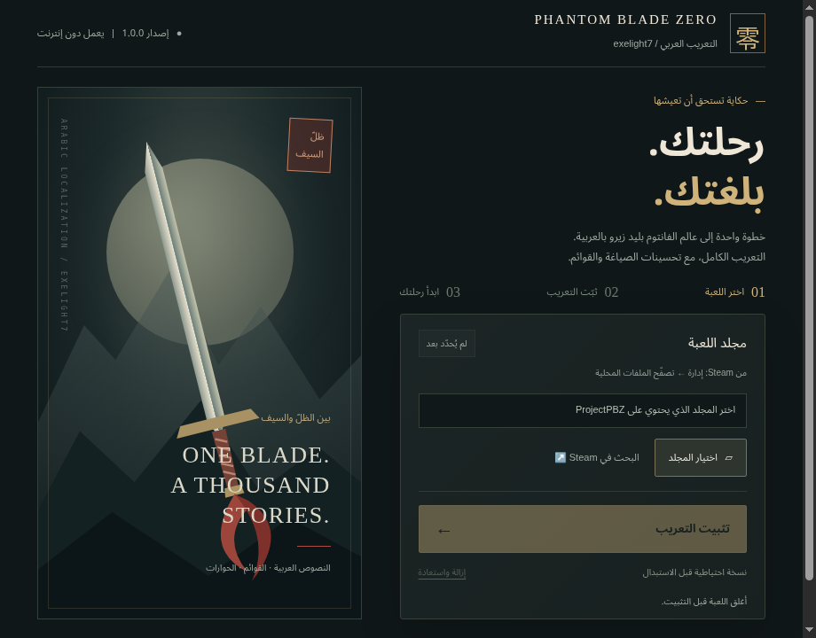

<div align="center">


# Phantom Blade Zero · العربية

**صياغة أوضح، مصطلحات متسقة، وتجربة عربية أفضل.**

تحسينات التعريب بإشراف **exelight7**

[صفحة الإصدارات](https://github.com/exelight7/PhantomBladeZero_AR/releases) · [دليل المشروع](GUIDE.md) · [سجل التحسينات](fixes/exelight7.md)


</div>

---

## ✨ ما الجديد؟

- تحسين صياغة القوائم ورسائل الحفظ وشروحات إعدادات الرسوميات والصوت.
- مراجعة كاملة لكل الحوارات (5,037 سطرًا) ثم رسائل القراءة والمهمات وعبارات التحميل: تنوين منسي، ومطابقة الخطاب المؤنث، وأخطاء إملائية متفرقة. التفاصيل قبل التعديل وبعده في [سجل مراجعة الحوارات](fixes/dialogues.md).
- تصحيح أخطاء نحوية في أوصاف الأغراض، مع الحفاظ على المعنى.
- إظهار **«تعريب exelight7»** بجانب زر الإعدادات عند استخدام التعريب العربي.
- حزمة واحدة كاملة باسم `exelight7_P` (ثلاثة ملفات: `.pak` و`.utoc` و`.ucas`)، تحمل النصوص المحدّثة وملف القائمة معًا، فلا تحتاج حزمة تصحيح فوق مود آخر ولا يتوقف أثرها على ترتيب تحميل الحزم.
- قابلة لإعادة البناء، مع فحص النصوص وسلامة ملفات الحزمة.

تضم هذه المراجعة **30 تصحيحًا نصيًا جديدًا** إلى جانب التصحيحات السابقة. التفاصيل قبل التعديل وبعده في [سجل التحسينات](fixes/exelight7.md).

## 📦 الإصدار 1.0.0

[صفحة الإصدار والتنزيلات](https://github.com/exelight7/PhantomBladeZero_AR/releases/tag/1.0.0)

| طريقتك | الملف |
| --- | --- |
| Windows 64-bit | `PhantomBladeZero-AR-1.0.0-win-x64.exe` |
| Linux / Steam Deck | `PhantomBladeZero-AR-1.0.0-linux-x86_64.AppImage` |
| تثبيت يدوي كامل | `PhantomBladeZero-AR-1.0.0-manual.zip` |

للتثبيت اليدوي السهل: فك ZIP وانسخ مجلد `ProjectPBZ` إلى مجلد اللعبة. الحزمة تشمل كل ما يلزم في ثلاثة ملفات.

> ملفات الإصدار 1.0.0 المنشورة بُنيت بالتسمية القديمة (`3BADIOH_P.*` و`ZZZ_3BADIOH_Fix_P.pak`). الأسماء الجديدة `exelight7_P.*` تظهر في الإصدار التالي؛ لبنائها الآن: `python3 tools/prepare_release.py`.

أو افتح التطبيق واختر مجلد اللعبة ثم «تثبيت التعريب». يعمل دون إنترنت ويحتفظ بنسخة احتياطية للملفات المستبدلة. [تعليمات التطبيق والاستعادة](installer/README.md).



## 🎮 التركيب

1. من Steam، افتح **إدارة ← تصفّح الملفات المحلية** للعبة.
2. **احذف أي تعريب عربي سابق** من `ProjectPBZ/Content/Paks/~mods`؛ فلا يجتمع تعريبان معًا. الأسماء القديمة لهذا المشروع: `3BADIOH_P.pak` و`3BADIOH_P.utoc` و`3BADIOH_P.ucas` و`ZZZ_3BADIOH_Fix_P.pak`.
3. انسخ مجلد `ProjectPBZ` من ملف `manual.zip` إلى مجلد اللعبة، فتصبح الملفات هكذا:

   ```text
   ProjectPBZ/Content/Paks/~mods/
   ├── exelight7_P.pak
   ├── exelight7_P.utoc
   └── exelight7_P.ucas
   ```

4. من **شاشة البداية**، افتح **Settings → Text Language** واختر **Français**. التعريب يستخدم خانة اللغة الفرنسية، ويظهر «تعريب exelight7» بجانب زر الإعدادات.

**للإزالة:** احذف الملفات الثلاثة أعلاه فقط.

> الحزمة اجتازت الفحص البنيوي والآلي. ظهورها وسلوكها داخل اللعبة يحتاجان تجربة فعلية.

## 🛠️ التحقق وإعادة البناء

تحتاج إلى **Python 3.10 أو أحدث** فقط؛ دون مكتبات خارجية. نفّذ الأوامر من جذر المستودع:

```bash
# التحقق من التصحيحات وملف القائمة دون كتابة الحزمة
python3 tools/apply_patches.py --dry

# تشغيل اختبارات الحزمة وتغيير الاسم
python3 -m unittest discover -s tests -v

# دمج التصحيحات وبناء حزمة الإصدار
python3 tools/apply_patches.py
```

تظهر الحزمة `exelight7_P.pak` في `release/ProjectPBZ/Content/Paks/~mods/`، ويُحفظ تقرير البناء في [release/apply_report.txt](release/apply_report.txt). لتجهيز الملفات الثلاثة وحزمة ZIP والمثبّت: `python3 tools/prepare_release.py`.

الحزمة المبنية كاملة: خطوط الواجهة والنصوص العربية المحدّثة وملف القائمة الذي يعرض اسم **exelight7**، وكلها في ملف واحد. أما `.utoc` و`.ucas` فنسختان بايتًا ببايت من حاويتَي الواجهة في `original_mod/` تُنسخان بالاسم الجديد. وتبقى ملفات المود الأساسي في `original_mod/` مرجعًا للبناء والمقارنة ولا تُعدَّل.

## 🗺️ أين أجد الحوارات والقوائم؟

[خريطة المشروع](docs/PROJECT_MAP.md) · [الفهرس الكامل لكل النصوص](docs/text-index/README.md) · [الحوارات](docs/text-index/Dlg.md) · [القوائم والإعدادات](docs/text-index/UI.md)

## 📂 ملفات المشروع

| المسار | المحتوى |
| :--- | :--- |
| [patches/](patches/) | التصحيحات النصية المعتمدة |
| [fixes/](fixes/) | سجلات التغييرات قبل التعديل وبعده |
| [glossary/GLOSSARY.md](glossary/GLOSSARY.md) | المصطلحات المعتمدة للمراجعة |
| [work/](work/) | دفعات المراجعة ومخرجاتها |
| [tools/](tools/) | أدوات فحص النصوص وبناء الحزمة وتخصيص اسم القائمة |
| [tests/](tests/) | اختبارات سلامة الحزمة والتعديلات |
| [data/](data/) | النصوص الأصلية المستخرجة وتقارير الفحص |
| [release/](release/) | حزمة `exelight7_P.pak` المبنية وتقرير البناء |
| [original_mod/](original_mod/) | ملفات المود الأساسي (مرجع البناء) |

## 🤝 المساهمة

ابدأ بـ [دليل المشروع](GUIDE.md)، ثم [قواعد المراجعة](tasks/COMMON_RULES.md) و[المسرد](glossary/GLOSSARY.md). حافظ على الوسوم مثل `<...>` والمتغيرات مثل `{0}`، وتحقق من التعديلات قبل دمجها.

## المصدر

تطوير هذه النسخة وتحسيناتها: **exelight7**. التعريب الأساسي من **3BADIOH**؛ تفاصيله في [ملف المود الأصلي](original_mod/README_3BADIOH.txt). ترخيص أدوات المستودع في [LICENSE](LICENSE).
